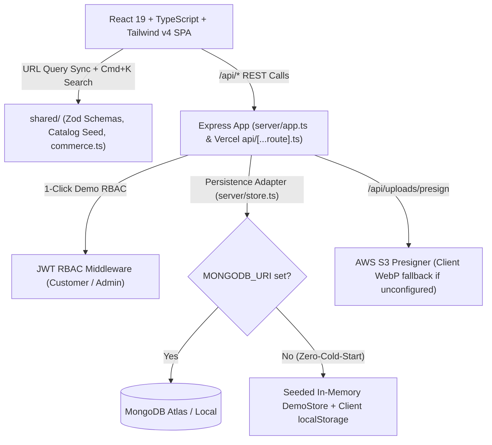
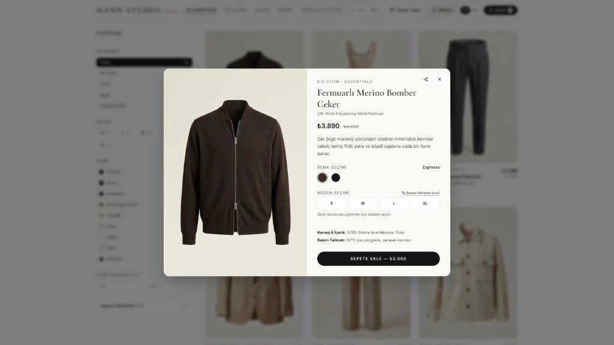
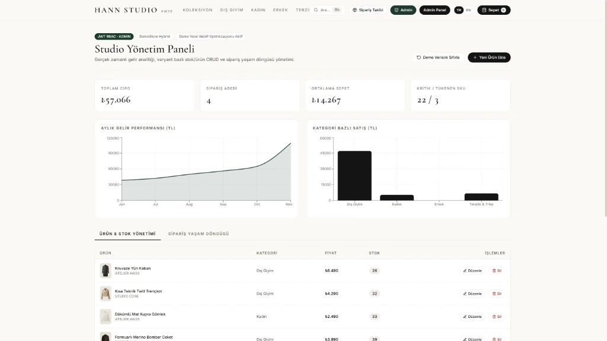
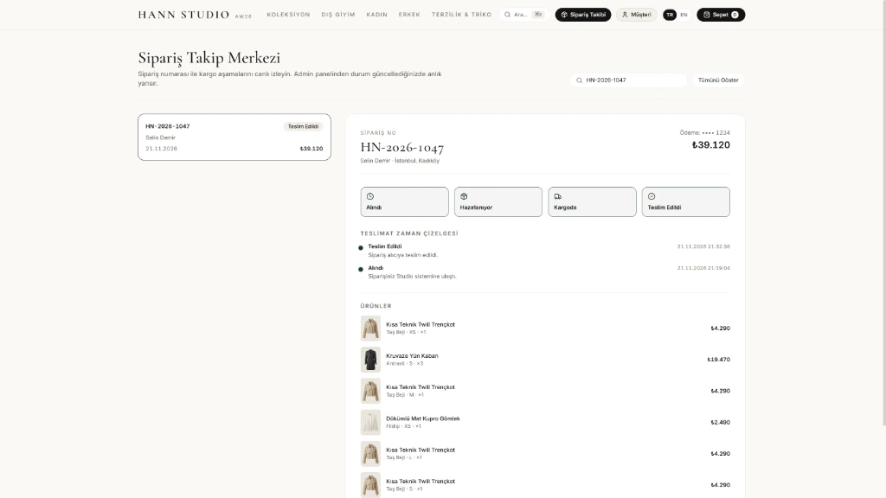

# HANN Studio — Full-Stack E-Commerce Platform

A full-stack editorial fashion & lifestyle concept store engineered with **React 19, TypeScript, Tailwind CSS v4, Express, MongoDB + Instant DemoStore, JWT RBAC, and an AWS S3 presigned upload adapter**.

**[Live Demo](https://ecommerce-mern-platform.vercel.app/)** · **[Portfolio Case Study](https://kadircelikportfolyo.vercel.app/#projects)**


---

## Architecture



---

## Key Engineering Highlights & Trade-Offs

- **Zero-Cold-Start Hybrid Persistence (`server/store.ts`)**: Ships with a seeded `DemoStore` (paired with client `localStorage` persistence) so visitors can test both storefront and admin flows immediately without signup barriers or cold starts, switching automatically to `MongoStore` when `MONGODB_URI` is configured.
- **URL-Synced Faceted Filtering & `Cmd+K` Command Palette (`shared/commerce.ts`)**: Bidirectional query-parameter sync (`category`, `size`, `color`, `minPrice`, `maxPrice`, `inStock`, `q`, `sort`) with live facet counts, shareable `?product=` deep links, and keyboard-accessible instant search.
- **Per-SKU Stock Guard & Multi-Step Checkout**: Enforces live variant inventory boundaries during bag updates and checkout (`409 INSUFFICIENT_STOCK` guard with conditional stock deduction & rollback on insufficient stock) alongside coupon rules (`HANN10`, `STUDIO20`, `FREESHIP`) and Zod-validated 3-step checkout.
- **1-Click JWT RBAC Operations Console (`Customer ↔ Admin`)**: Issues signed JWTs via `/api/auth/demo-switch` (restricting customer views to their own orders) and protects product/variant CRUD, Recharts revenue analytics, AWS S3 presigning (`/api/uploads/presign`, falling back to client-side WebP encoding when S3 credentials aren't set), and 4-stage order lifecycle updates (`received → preparing → shipped → delivered`).
- **Code Splitting & Bilingual UI (`TR / EN`)**: Route/view lazy loading via `React.lazy` alongside full Turkish and English localization across catalog filters, checkout validation, order tracking, and admin analytics.

---

## Screenshots

| Faceted Catalog & Filters | Multi-Step Checkout & Tracking | JWT Admin Console & Analytics |
| :---: | :---: | :---: |
|  |  |  |

---

## Project Structure

```text
ecommerce-mern-platform/
├── .github/workflows/     # GitHub Actions CI pipeline
├── api/[...route].ts      # Vercel Serverless entry forwarding /api/* to Express
├── public/products/       # Product .webp studio imagery
├── server/
│   ├── app.ts             # Express REST API routes & error handling
│   ├── auth.ts            # JWT signing & Customer/Admin RBAC middleware
│   ├── index.ts           # Standalone Node server entry
│   ├── s3.ts              # AWS S3 presigned URL upload adapter
│   └── store.ts           # Automatic MongoStore / in-memory DemoStore switcher
├── shared/
│   ├── catalogSeed.ts     # Editorial catalog & variant seed
│   ├── commerce.ts        # Pure URL query sync, faceting, coupon & checkout math
│   ├── schemas.ts         # Shared Zod validation schemas
│   └── types.ts           # Shared domain types
├── src/                   # React 19 + TypeScript + Tailwind v4 SPA (TR / EN)
├── tests/                 # Vitest unit & Supertest API integration suites
├── .env.example
├── vercel.json
└── vitest.config.ts
```

---

## Local Setup & Verification

```bash
npm install
npm run dev        # Vite SPA on http://localhost:5173 (proxies /api to server)
npm run server     # Standalone Express API server (tsx server/index.ts)
npm run typecheck  # Strict TypeScript check (tsc --noEmit)
npm test           # Vitest unit + Supertest API suite
npm run build      # Production Vite bundle
```

Optional environment variables in `.env` (see `.env.example`):

- `MONGODB_URI`, `MONGODB_DB`, `JWT_SECRET`
- `AWS_REGION`, `AWS_ACCESS_KEY_ID`, `AWS_SECRET_ACCESS_KEY`, `AWS_S3_BUCKET`
